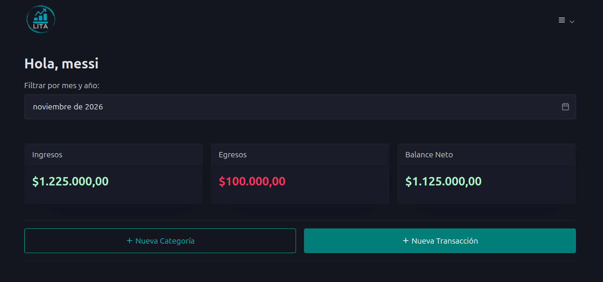
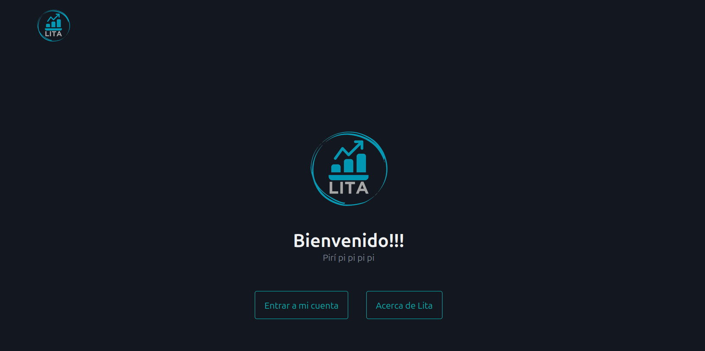
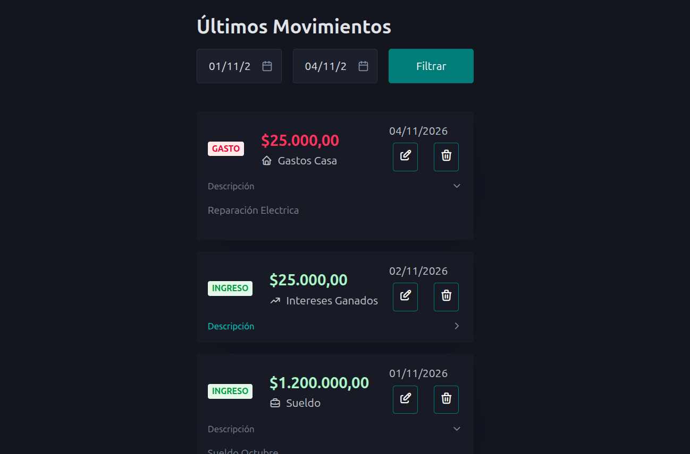
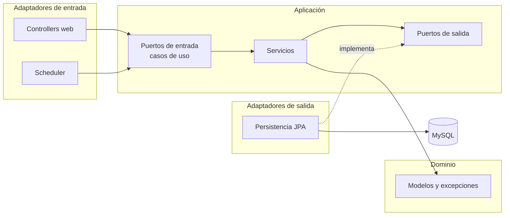

# Hexa Finance

Aplicación web de finanzas personales: registrá ingresos y gastos, organizalos por categoría, programá movimientos recurrentes y mirá reportes y un resumen de tu balance.

Es también un ejercicio de **arquitectura hexagonal** con Spring Boot: el dominio y los casos de uso no dependen de ningún framework.

## Capturas





## Funcionalidades

- Registro e inicio de sesión.
- Transacciones de ingreso y gasto, con alta, edición y baja.
- Categorías propias.
- **Transacciones recurrentes** que se generan solas con un proceso programado (todos los días a la 01:00).
- Reportes por categoría y resumen en el dashboard.
- Perfil: cambio de nombre de usuario, email y contraseña.
- Panel de administración: listado de usuarios, activación y desactivación, y generación de contraseñas.
- Cambio de contraseña obligatorio cuando el administrador genera una nueva.

## Stack

| Pieza | Para qué |
|---|---|
| Java 25 + Spring Boot 4.1.1 | Aplicación |
| Spring Data JPA / Hibernate | Persistencia |
| Spring Security | Autenticación y roles |
| Thymeleaf | Vistas renderizadas en el servidor |
| htmx | Actualizaciones parciales sin recargar |
| Pico CSS y Tabler Icons | Estilos e iconos |
| MySQL 8.4 | Base de datos |
| Docker Compose | Aplicación, base de datos y phpMyAdmin |

## Arquitectura

El proyecto sigue el patrón de puertos y adaptadores. Las dependencias apuntan siempre hacia adentro: la infraestructura conoce a la aplicación y al dominio, pero nunca al revés.



- **`domain`:** modelos y excepciones de negocio, sin dependencias de frameworks.
- **`application`:** los casos de uso (puertos de entrada), los puertos de salida y los servicios que los implementan.
- **`infrastructure`:** los adaptadores. Controllers web, scheduler y persistencia con JPA, además de la configuración de seguridad y de los beans.

Cada adaptador de persistencia traduce entre las entidades JPA y los modelos del dominio con mappers, así que JPA no se filtra hacia adentro. Los servicios se registran como beans desde clases `*BeanConfig`, y los puertos de salida los resuelve Spring al inyectar los adaptadores.

## Estructura

```
.
├── docker-compose.yml
├── docker/
│   └── mysql_init/            # Script SQL inicial
├── docs/
└── hexa-finance/
    ├── Dockerfile
    └── src/
        ├── main/java/com/mat/hexa_finance/
        │   ├── domain/        # model, exception
        │   ├── application/   # ports (in/out), service
        │   └── infrastructure/
        │       ├── adapters/in/    # web, scheduling
        │       ├── adapters/out/   # persistence
        │       └── confi
        └── test/
```

## Cómo levantarlo

**Requisitos:** Docker con Docker Compose.`

| Servicio | URL |
|---|---|
| Aplicación | http://localhost:8080 |
| phpMyAdmin | http://localhost:8081 |

MySQL y phpMyAdmin solo escuchan en `127.0.0.1`.

El script de `docker/mysql_init/` se ejecuta únicamente la primera vez, cuando el volumen de MySQL está vacío. Si lo cambiás después, hay que borrar el volumen para que se vuelva a aplicar.

**Usuario inicial:** admin@admin.com creaso en UserDataInitializer

### Ejecutar sin Docker

Con una base MySQL propia y un `finance_db` creado, ajustá `application.properties` y corré:

```bash
cd hexa-finance
./mvnw spring-boot:run
```

## Tests

```bash
cd hexa-finance
./mvnw test
```

Hay tests unitarios de los servicios (categorías, perfil, transacciones y transacciones recurrentes automáticas) y tests de los repositorios JPA (dashboard y transacciones).

## Decisiones técnicas

- **Arquitectura hexagonal**, para que la lógica de negocio se pueda probar sin base de datos ni servidor web.
- **Un caso de uso por interfaz**, con comandos (`CreateTransactionCommand`) como entrada de los casos de uso.
- **Modelos de dominio separados de las entidades JPA**, con mappers entre ambos.
- **Vistas con fragmentos y htmx**: el servidor devuelve solo el fragmento que cambia.
- **Procesamiento de recurrentes con un scheduler**, configurable desde `app.scheduling.recurring-transactions-cron`.

## Limitaciones

- Puede pulirse muchisimo más sobre todo la parte de los reportes.
- Configuración pensada para desarrollo (`ddl-auto=update`, sin migraciones).

## Licencia

Ver el archivo [LICENSE](LICENSE).

## Créditos

[Pico CSS](https://picocss.com/) y [Tabler Icons](https://tabler.io/icons).
